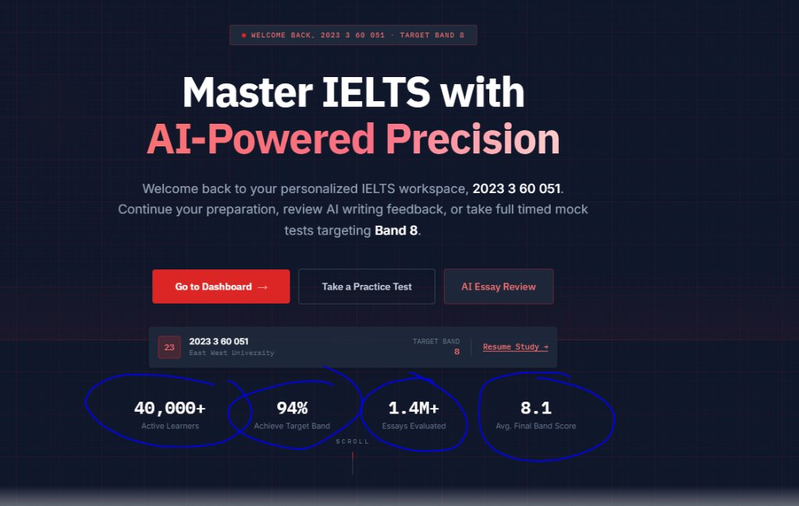
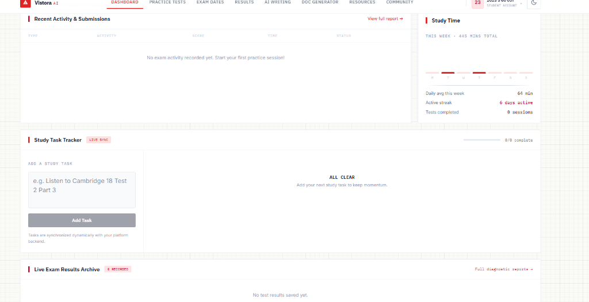
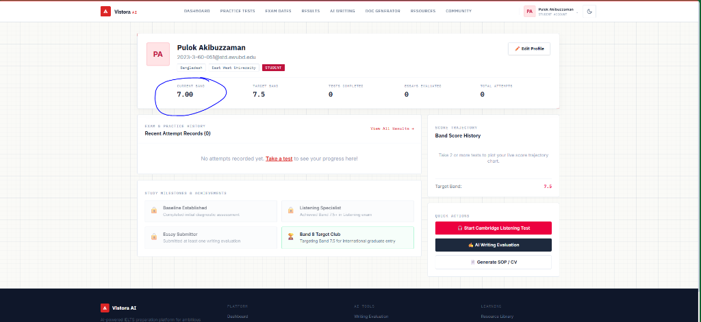
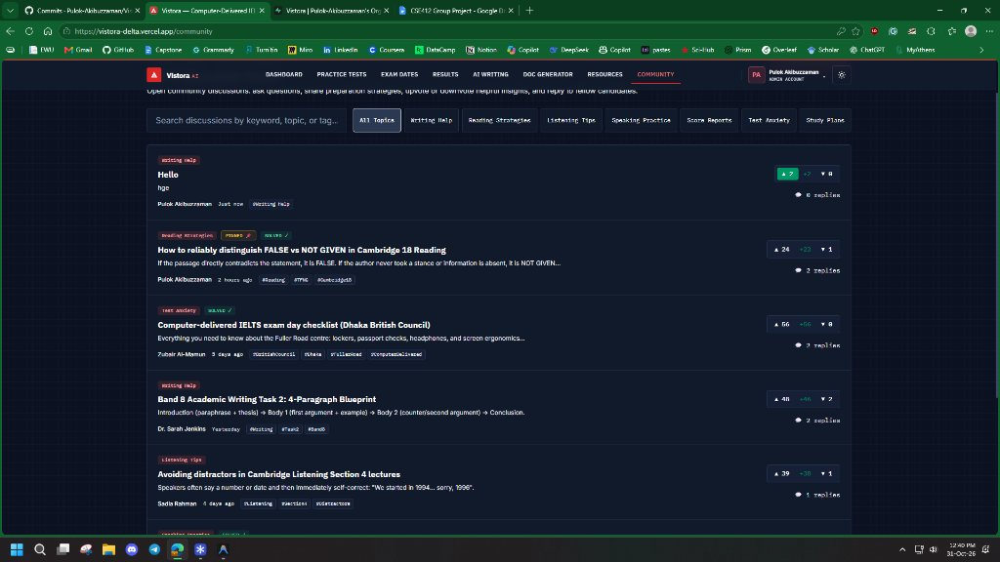
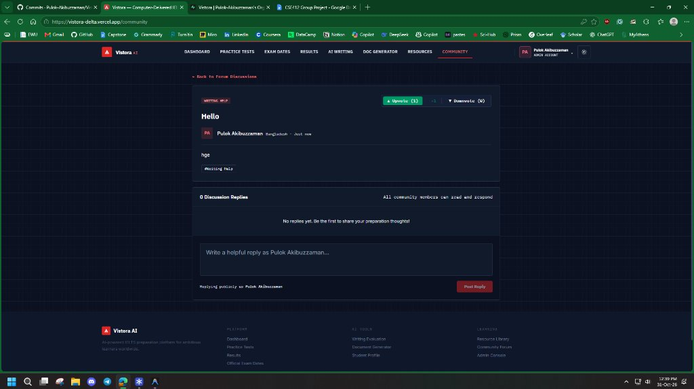
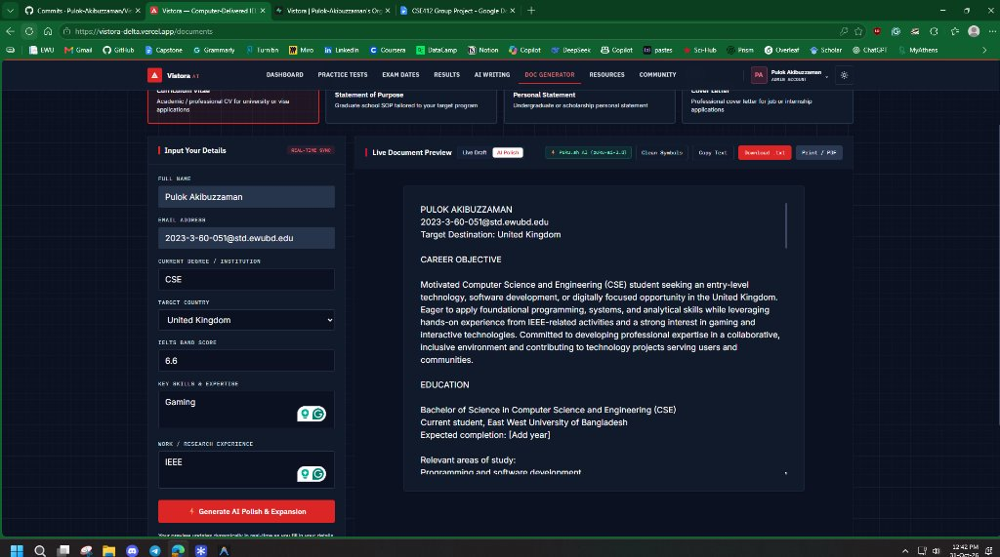
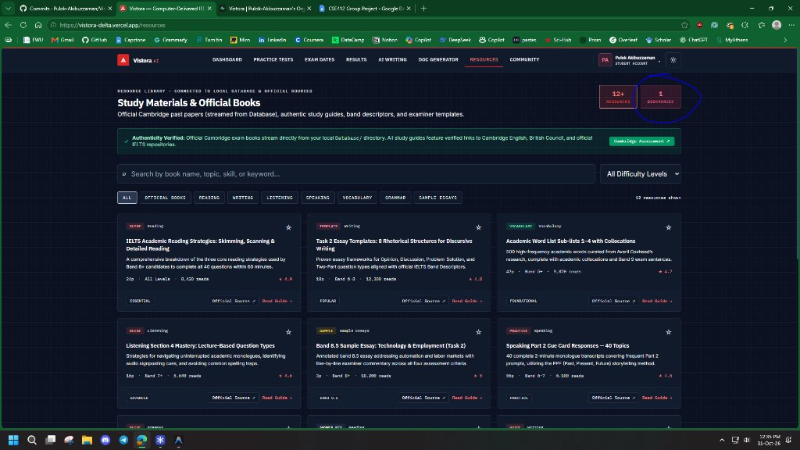

# 🎓 Vistora — Computer-Delivered IELTS Preparation & AI Platform

[](https://github.com/Pulok-Akibuzzaman/Vistora)
[](https://github.com/Pulok-Akibuzzaman/Vistora)
[](https://react.dev)
[](https://vitejs.dev)
[](https://supabase.com)
[](https://vercel.com)

> **Live Platform:** [https://vistora-delta.vercel.app](https://vistora-delta.vercel.app)  
> **Official Repository:** [https://github.com/Pulok-Akibuzzaman/Vistora](https://github.com/Pulok-Akibuzzaman/Vistora)  
> **Academic Institution:** East West University (EWU), Dhaka, Bangladesh  
> **Department:** Department of Computer Science & Engineering (CSE)  
> **Course:** CSE412 — Software Engineering / Systems Project  

---

## 📸 Screenshots & Visual Tour

Here is what Vistora looks like in action:

### 1. Home & Hero Landing Page
*Clean, modern landing page with live platform statistics, Cambridge test shortcuts, and IELTS preparation tools.*


---

### 2. Candidate Dashboard & Study Task Tracker
*Your personal IELTS study room featuring your live study time, active streak, and dynamic to-do task tracker.*


---

### 3. Student Profile & Live Band Score Trajectory
*Real-time diagnostic band scores calculated from your practice tests, target band tracking, and milestones.*


---

### 4. IELTS Community Discussion Forum
*Real-time discussion board where students ask questions, upvote helpful tips, and auto-pin top-voted discussions.*


---

### 5. Community Thread Discussion & Reply View
*Clean discussion thread view allowing candidates to share preparation tips and teachers to give guidance.*


---

### 6. AI Application Document Generator
*Generate customized Curriculum Vitae (CV), Statement of Purpose (SOP), Personal Statement, or Cover Letters with clean, print-ready PDF export.*


---

### 7. Official Resource Library & Cambridge Books
*Official Cambridge IELTS past papers, audio files, grammar guides, and dynamic Supabase-saved bookmarks.*


---

## 📖 What is Vistora? (In Simple Words)

Preparing for the official computer-delivered IELTS exam can be stressful and expensive. Many test centers charge high fees just for a single mock test, and standard paper practice does not prepare you for the real computer exam room.

**Vistora** solves this problem. It is a free, web-based platform designed to give students in Bangladesh and across the world the **exact look, feel, and features** of the real British Council and IDP computer-delivered IELTS test.

With Vistora, you can:
1. **Take authentic full-length practice tests** on screen with the official split-screen layout, audio controls, and 40-question navigation bar.
2. **Get instant band score results** (Band 0 to 9.0) with detailed answers and cited explanations without waiting days for a teacher to grade it.
3. **Submit essays for AI evaluation** to receive instant feedback on Task Achievement, Coherence, Vocabulary, and Grammar.
4. **Create professional academic documents** (CV, SOP, Personal Statement, Cover Letter) for university and visa applications abroad.
5. **Ask questions and share preparation strategies** with fellow students on the real-time community forum.
6. **Track your daily study tasks and official exam dates** across Dhaka, Chattogram, and Sylhet test centers.

---

## 🌟 Key Features Breakdown

### 🎧 1. Authentic Computer-Delivered Test Simulator
- **Exact Official Layout**: Left side displays the passage or audio player; right side displays the questions with smooth independent scrolling.
- **Full 40-Question Palette**: Jump directly to any question, mark tricky questions for review with a yellow flag, and view completion status at a glance.
- **Official Cambridge Materials**: Complete reading tests from **Cambridge IELTS 21** and **Cambridge IELTS 18–20**, plus listening tests with audio player speed controls (1.0x, 1.25x, 1.5x).
- **Instant Automatic Grading**: Zero waiting time. The system calculates your overall band score immediately using official IELTS conversion formulas.

### ✍️ 2. AI Writing Essay Examiner
- Supports both **Task 1** (Charts, Graphs, Processes) and **Task 2** (Discursive Essays).
- Grades your writing across the 4 official IELTS criteria:
  - *Task Achievement / Task Response*
  - *Coherence and Cohesion*
  - *Lexical Resource (Vocabulary)*
  - *Grammatical Range and Accuracy*
- Highlights strengths, points out mistakes, and offers improved vocabulary alternatives.

### 📄 3. Application Document Generator (CV, SOP, PS, Cover Letter)
- Generates tailored documents for university admissions, embassy visa interviews, and job applications.
- **Only generates on user request**: Preview waits until you click the generate button so you are always in control.
- **Isolated Clean PDF / Print Engine**: Prints or saves only your formatted document with professional margins and clean typography, completely hiding website menus and headers.

### 📊 4. Student Dashboard & Study Task Tracker
- Visual band score summary and exam history.
- Live study task planner that lets you add, complete, and delete your daily study goals with instant database sync.

### 💬 5. Community Forum & Discussion Board
- Ask preparation questions, vote on helpful answers, and reply to fellow candidates.
- **Top-voted discussions are automatically pinned** to the top of the forum so everyone finds the best advice first.
- **Admin Moderation**: Platform admins can pin important announcements and delete spam, while students can delete their own posts.

### 📚 6. Study Materials & Resource Library
- Download official Cambridge past papers and access verified reading and writing templates.
- **One-click bookmarking**: Save your favorite guides to your account with real-time cloud synchronization.

---

## 🚀 How to Run the Project Offline on Your Computer

You can run Vistora completely locally on your computer. The application is designed to be fully functional **even if you have no internet connection**, because all Cambridge test datasets, scoring formulas, audio files, and offline document templates are packaged inside the project!

### Prerequisites
Make sure you have Node.js installed on your computer:
- **Node.js**: Version 18.0.0 or higher ([Download Node.js](https://nodejs.org))
- **npm**: Comes automatically with Node.js

---

### Step-by-Step Offline Setup Guide

#### Step 1: Open Your Terminal
- On Windows: Press `Win + R`, type `powershell` or `cmd`, and press Enter.
- On Mac/Linux: Open the `Terminal` application.

#### Step 2: Navigate to the Project Folder
```bash
cd "path/to/Vistora"
```
*(For example: `cd "F:\EWU\CSE412\Project\Vistora"`)*

#### Step 3: Install Required Packages
Run this command once to install the project dependencies:
```bash
npm install
```

#### Step 4: Start the Local Development Server
```bash
npm run dev
```

#### Step 5: Open in Your Browser
After running the command, you will see a message in the terminal:
```text
  VITE v8.x.x  ready in 250 ms

  ➜  Local:   http://localhost:3000/
  ➜  Network: use --host to expose
```
Hold `Ctrl` and click the link, or open your web browser (Chrome, Edge, Firefox, or Safari) and navigate to:
```text
http://localhost:3000
```

---

### Why Vistora Works 100% Offline
- **Built-in Cambridge Datasets**: Authentic Reading tests (Cambridge 18 and 21) and audio passages are bundled locally in `src/data/` and `Database/`.
- **Instant Offline Grading**: The grading formulas execute directly inside your browser without contacting an external server.
- **Local Storage Fallback**: User accounts, study tasks, bookmarked resources, and forum posts automatically save to browser storage if you are offline.
- **Offline Document Compilation**: If an external AI connection is unavailable, Vistora uses its built-in academic template engine to generate complete, formatted CVs, SOPs, and cover letters offline.

---

## 🏗️ Project Directory Structure

Here is how the project files are organized:

```text
Vistora/
├── api/                          # Vercel serverless cloud endpoints
│   ├── exam-dates.ts             # Live British Council Bangladesh exam schedule API
│   └── forum.ts                  # Centralized Supabase forum synchronization API
├── Database/                     # Official Cambridge IELTS resources
│   ├── IELTS 18.pdf              # Cambridge 18 complete authentic test book
│   ├── IELTS 19.pdf              # Cambridge 19 complete authentic test book
│   ├── IELTS 20.pdf              # Cambridge 20 complete authentic test book
│   ├── IELTS 21.pdf              # Cambridge 21 complete authentic test book
│   └── IELTS 18-21 AUDIO/        # Authentic Listening test MP3 audio tracks
├── public/                       # Static public assets
│   ├── favicon.svg               # Vistora logo icon
│   └── screenshots/              # High-resolution screenshots for GitHub preview
├── src/                          # Application source code
│   ├── components/               # Reusable interface components
│   │   ├── FullTestResult.tsx    # Diagnostic test score card & review modal
│   │   ├── Layout.tsx            # Navigation bar, header, and footer layout
│   │   ├── Motion.tsx            # Smooth animations & transitions
│   │   └── RequireAuth.tsx       # Protected route guard
│   ├── data/                     # Exam datasets, passages, & answer keys
│   │   ├── listeningTest1.ts     # Cambridge 18 Listening Test 1 data
│   │   ├── listeningTest2.ts     # Cambridge 18 Listening Test 2 data
│   │   ├── readingTest1.ts       # Cambridge 18 Reading Passage 1 data
│   │   ├── readingTest2.ts       # Cambridge 18 Reading Passage 2 data
│   │   ├── readingTest21.ts      # Cambridge 21 authentic test questions
│   │   └── resourceGuides.ts     # IELTS vocabulary and preparation guides
│   ├── lib/                      # Core logic & backend integration
│   │   ├── api.ts                # API client, database sync, & offline fallbacks
│   │   ├── authContext.tsx       # User login, signup, session, and role state
│   │   ├── customTests.ts        # Custom PDF test parser
│   │   ├── examDates.ts          # Exam date queries and filtering
│   │   ├── pukuAi.ts             # Puku.sh AI client integration
│   │   ├── scoring.ts            # Official IELTS Band 9.0 scoring engine
│   │   ├── supabaseClient.ts     # Supabase database initialization
│   │   └── theme.tsx             # Dark and light theme switcher
│   ├── pages/                    # Main platform views
│   │   ├── AdminDashboard.tsx    # Admin console & management panel
│   │   ├── Auth.tsx              # Login & student registration view
│   │   ├── CommunityForum.tsx    # Peer discussion board with live sync
│   │   ├── Dashboard.tsx         # Student study room & task tracker
│   │   ├── DocGenerator.tsx      # AI CV, SOP, and Cover Letter generator
│   │   ├── ExamDates.tsx         # Searchable British Council test schedules
│   │   ├── Landing.tsx           # Homepage & interactive feature showcase
│   │   ├── PracticeTest.tsx      # Authentic computer-delivered exam room
│   │   ├── ResourceLibrary.tsx   # Cambridge book archive & dynamic bookmarks
│   │   ├── Results.tsx           # Exam attempt archive & score review
│   │   ├── UserProfile.tsx       # Student profile, band score, & settings
│   │   └── WritingEval.tsx       # AI Writing essay evaluator & score predictor
│   ├── App.tsx                   # Main React root application
│   ├── index.css                 # Global styles, typography, & print rules
│   ├── main.tsx                  # Application entry point
│   └── routes.ts                 # Page routing definitions
├── supabase/                     # Cloud database configuration
│   └── schema.sql                # Complete PostgreSQL schema, triggers, & RLS
├── package.json                  # Project dependencies and run scripts
├── tsconfig.json                 # TypeScript compiler configuration
├── vercel.json                   # Vercel deployment & routing settings
├── vite.config.ts                # Vite build and dev server configuration
└── README.md                     # Comprehensive project documentation
```

---

## 💡 Technologies Used & Why We Chose Them (Easy to Understand)

| Technology | What It Does | Why We Chose It (In Simple Words) |
| :--- | :--- | :--- |
| **React 19** | Frontend Framework | Lets us build the website like interlocking Lego blocks. When you click an answer or update a task, React updates only that specific box on screen instantly without reloading the page. |
| **TypeScript** | Programming Language | Like JavaScript with a safety net. It catches typos and errors while coding so students never experience broken buttons or missing data during an exam. |
| **Vite 8** | Dev Server & Bundler | Starts the local website in less than 1 second and packages all code cleanly for fast production loading. |
| **Supabase** | Cloud Database & Auth | Provides a secure PostgreSQL database in the cloud to store user accounts, test scores, study tasks, and discussion threads across devices. |
| **Vanilla CSS + Tokens** | Styling & Theme | Delivers the authentic dark and light exam-room look matching the official British Council test screen. |
| **Vercel** | Cloud Hosting | Automatically deploys our updates directly from GitHub to a worldwide content delivery network for fast global access. |

---

## 👥 Course Information & Contributors

This platform was developed as an academic project for **CSE412 (Software Engineering / Systems Project)** at **East West University (EWU)**, Dhaka, Bangladesh.

### Team Members & Contributors
- **[Pulok-Akibuzzaman (Pulok Akibuzzaman)](https://github.com/Pulok-Akibuzzaman)** — *Project Architecture, Frontend & Backend Integration*
- **[afrasultana-12 (Afra Sultana)](https://github.com/afrasultana-12)** — *UI Design & Component Development*
- **[ahmed-mannan (Ahmed Mannan)](https://github.com/ahmed-mannan)** — *IELTS Content & Test Datasets*
- **[Nusrat60-057 (Nusrat Rahman Aurna)](https://github.com/Nusrat60-057)** — *Quality Assurance & User Testing*
- **[roxZach (Ibna Jiam)](https://github.com/roxZach)** — *Research & Scoring Models*

---

<p align="center">
  <b>Vistora</b> · Built with ❤️ for ambitious IELTS candidates worldwide.
</p>
